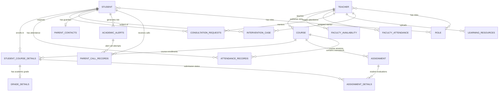

# Project 577 — Complete Repository Analysis and Handover Report
**Digital Academic Performance Monitoring and Institutional Analytics System (Project 577)**  
*Audited Workspace*: `c:\Users\yeswanth kumar\Documents\student managment project`  
*Target Auditor*: Google Gemini Pro (Handover for Architecture, Debugging & Improvement)  
*Status*: Production-Grade Deep Technical Handover  

---

## 1. Project Overview & Confirmed Technology Stack

Project 577 is a three-tier institutional academic intelligence, student progress monitoring, and parent communication enterprise application. The codebase integrates administrative governance, teacher workflow orchestration, student learning analytics, deep learning performance forecasting, and automated telephony-based academic alerts for parents.

### Confirmed Technology Matrix (Verified against Active Source Files)

| Layer | Component / Tool | Declared / Confirmed Version | Evidence File & Line | Status |
| :--- | :--- | :--- | :--- | :--- |
| **Frontend Runtime** | React & React-DOM | `^18.3.1` | [package.json](file:///c:/Users/yeswanth%20kumar/Documents/student%20managment%20project/Frontend/School-Management-System/frontend/package.json#L14-L15) | **Verified** |
| **Frontend Bundler** | Vite | `^5.2.11` | [package.json](file:///c:/Users/yeswanth%20kumar/Documents/student%20managment%20project/Frontend/School-Management-System/frontend/package.json#L20) | **Verified** |
| **Frontend Routing** | React Router DOM | `^6.23.1` | [package.json](file:///c:/Users/yeswanth%20kumar/Documents/student%20managment%20project/Frontend/School-Management-System/frontend/package.json#L16) | **Verified** |
| **HTTP Client** | Axios | `^1.7.2` | [package.json](file:///c:/Users/yeswanth%20kumar/Documents/student%20managment%20project/Frontend/School-Management-System/frontend/package.json#L12) | **Verified** |
| **UI Iconography** | Lucide React | `^0.383.0` | [package.json](file:///c:/Users/yeswanth%20kumar/Documents/student%20managment%20project/Frontend/School-Management-System/frontend/package.json#L13) | **Verified** |
| **Frontend Styling** | Custom CSS Design System | Vanilla CSS (Light/Dark design tokens) | [index.css](file:///c:/Users/yeswanth%20kumar/Documents/student%20managment%20project/Frontend/School-Management-System/frontend/src/index.css#L1-L150) | **Verified** |
| **Backend Framework** | Spring Boot | `2.6.3` (starter-parent) | [pom.xml](file:///c:/Users/yeswanth%20kumar/Documents/student%20managment%20project/Student-Management-System/pom.xml#L7-L9) | **Verified** |
| **JDK Compatibility** | Java Version | Running on OpenJDK 21 (properties declare Java 11) | [pom.xml](file:///c:/Users/yeswanth%20kumar/Documents/student%20managment%20project/Student-Management-System/pom.xml#L17) | **Verified** |
| **Backend Persistence**| Spring Data JPA / Hibernate | 5.6.4.Final (managed by Spring Boot 2.6.3) | [pom.xml](file:///c:/Users/yeswanth%20kumar/Documents/student%20managment%20project/Student-Management-System/pom.xml#L21-L24) | **Verified** |
| **Relational Database** | MySQL 8.x | Connector: `mysql-connector-java` | [pom.xml](file:///c:/Users/yeswanth%20kumar/Documents/student%20managment%20project/Student-Management-System/pom.xml#L53-L56) | **Verified** |
| **Database Pool** | HikariCP | Managed by Spring Boot | [application.properties](file:///c:/Users/yeswanth%20kumar/Documents/student%20managment%20project/Student-Management-System/src/main/resources/application.properties#L4-L7) | **Verified** |
| **Security & Auth** | Spring Security 5 + Cookie Session | `HttpSession` session cookies (`JSESSIONID`) | [DemoSecurityConfig.java](file:///c:/Users/yeswanth%20kumar/Documents/student%20managment%20project/Student-Management-System/src/main/java/com/Studentmangment/studentmanagement/config/DemoSecurityConfig.java#L18-L125) | **Verified** |
| **AI/ML Service** | FastAPI + Uvicorn | `fastapi>=0.110.0`, `uvicorn>=0.28.0` | [requirements.txt](file:///c:/Users/yeswanth%20kumar/Documents/student%20managment%20project/ai-service/requirements.txt#L1-L2) | **Verified** |
| **Deep Learning Engine**| PyTorch MLP Model | `torch>=2.2.0`, model `academic_mlp.pt` | [model_metadata.json](file:///c:/Users/yeswanth%20kumar/Documents/student%20managment%20project/ai-service/models/model_metadata.json#L1-L5) | **Verified** |
| **Machine Learning** | Scikit-Learn | `scikit-learn>=1.4.0`, Ridge regression & Scaler | [model_metadata.json](file:///c:/Users/yeswanth%20kumar/Documents/student%20managment%20project/ai-service/models/model_metadata.json#L50-L56) | **Verified** |
| **Voice / Telephony** | Dual Provider Engine | Browser Web Speech duplex + Exotel REST Client | [ParentVoiceAlerts.jsx](file:///c:/Users/yeswanth%20kumar/Documents/student%20managment%20project/Frontend/School-Management-System/frontend/src/pages/admin/ParentVoiceAlerts.jsx#L150-L240) | **Verified** |

> [!IMPORTANT]
> **Authentication Clarification**: The project does **NOT** use JSON Web Tokens (JWT). The system uses stateful HTTP Session authentication via `HttpSession` with `withCredentials: true` in Axios and cookies (`JSESSIONID`). All API requests carry session state managed by Spring Security's `HttpSessionSecurityContextRepository`.

---

## 2. Actual Repository Folder Structure

```
c:\Users\yeswanth kumar\Documents\student managment project\
├── ai-service/                                    # Python FastAPI AI/ML Microservice (Port 8000)
│   ├── app/
│   │   ├── config.py                              # Directory and model path configuration
│   │   ├── explainer.py                           # Explainable AI sensitivity attribution engine
│   │   ├── main.py                                # FastAPI app endpoints (/health, /api/ai/*)
│   │   ├── model.py                               # PyTorch MLP Neural Network architecture (3,329 params)
│   │   ├── pipeline.py                            # Data preprocessing and scaling pipeline
│   │   ├── schemas.py                             # Pydantic v2 validation contracts
│   │   └── service.py                             # ModelManager singleton inference coordinator
│   ├── data/                                      # Training dataset artifacts
│   ├── models/
│   │   ├── academic_mlp.pt                        # Trained PyTorch 2.x MLP weights
│   │   ├── baseline_ridge.joblib                  # Baseline Scikit-Learn Ridge model
│   │   ├── model_metadata.json                    # Hold-out evaluation metrics & training stats
│   │   └── scaler.joblib                          # Standard scaler artifact
│   ├── requirements.txt                           # Python dependencies
│   ├── test_ai_service.py                         # PyTest unit suite for ML inference & explainability
│   ├── test_all_portals.py                        # Automated integration test across portals
│   ├── test_complete_audit_pass.py                # End-to-end audit test validating predictions & schemas
│   └── train.py                                   # Training runner script
│
├── Frontend/School-Management-System/frontend/   # React + Vite Single Page Application (Port 5173)
│   ├── dist/                                      # Production bundle (Vite build output verified)
│   ├── public/                                    # Static browser assets
│   ├── src/
│   │   ├── components/                            # Reusable UI components
│   │   │   ├── common/                            # Button, DataTable, Input, Modal, ErrorState, LoadingSpinner
│   │   │   ├── layout/                            # Navbar, Sidebar, PageHeader
│   │   │   └── ui/                                # StatCard, Badge, MetricCard
│   │   ├── context/
│   │   │   └── AuthContext.jsx                    # React authentication context & session management
│   │   ├── hooks/
│   │   │   └── useAuth.js                         # Custom auth consumer hook
│   │   ├── layouts/
│   │   │   ├── AdminLayout.jsx                    # Admin layout wrapper with navigation sidebar
│   │   │   ├── StudentLayout.jsx                  # Student layout wrapper
│   │   │   └── TeacherLayout.jsx                  # Teacher layout wrapper
│   │   ├── pages/
│   │   │   ├── admin/                             # AdminDashboard, Students, Teachers, Courses, ParentVoiceAlerts
│   │   │   ├── auth/                              # LoginSelect, RoleLoginForm, Register, AccessDenied
│   │   │   ├── common/
│   │   │   │   └── AcademicModulePage.jsx         # Unified module hub (3,092 lines, 12 modules)
│   │   │   ├── student/                           # StudentDashboard, Courses, Assignments, Grades, Profile
│   │   │   └── teacher/                           # TeacherDashboard, Courses, Students, Assignments, Grades
│   │   ├── routes/
│   │   │   ├── AppRoutes.jsx                      # Client router (56 total routes)
│   │   │   ├── ProtectedRoute.jsx                 # Authenticated route gate
│   │   │   └── RoleRoute.jsx                      # Role-Based Access Control gate (STUDENT, TEACHER, ADMIN)
│   │   ├── services/
│   │   │   ├── academicService.js                 # API adapter for /api/academic/** and /api/ai/**
│   │   │   ├── adminService.js                    # API adapter for /api/admin/**
│   │   │   ├── api.js                             # Axios instance with withCredentials: true
│   │   │   ├── authService.js                     # API adapter for /api/auth/**
│   │   │   ├── courseService.js                   # API adapter for /api/courses/**
│   │   │   ├── interventionService.js             # API adapter for /api/interventions/**
│   │   │   ├── parentAlertService.js              # API adapter for /api/admin/parent-alerts/**
│   │   │   ├── studentService.js                  # API adapter for /api/students/**
│   │   │   └── teacherService.js                  # API adapter for /api/teachers/**
│   │   ├── utils/                                 # Formatting, date and export utilities
│   │   ├── App.jsx                                # Root application component
│   │   ├── index.css                              # Design system tokens and layout styles
│   │   └── main.jsx                               # DOM bootstrap entry
│   ├── index.html                                 # Single page entry HTML
│   ├── package.json                               # NPM dependencies and build scripts
│   └── vite.config.js                             # Vite configuration with React plugin
│
├── Student-Management-System/                     # Java Spring Boot Backend (Port 8080)
│   ├── src/main/java/com/Studentmangment/studentmanagement/
│   │   ├── client/
│   │   │   └── AiServiceClient.java               # RestTemplate client connecting to FastAPI port 8000
│   │   ├── config/
│   │   │   ├── CorsConfig.java                    # Allowed origins, headers, credentials config
│   │   │   ├── CustomAuthenticationSuccessHandler.java # Post-login routing handler
│   │   │   ├── DemoSecurityConfig.java            # Spring Security configuration (WebSecurityConfigurerAdapter)
│   │   │   └── DevelopmentSeedDataConfig.java     # Database seeder (6 Teachers, 30 Students, 6 Courses)
│   │   ├── controller/
│   │   │   ├── AdminController.java               # Legacy Thymeleaf admin controller
│   │   │   ├── LoginController.java               # Legacy Thymeleaf login controller
│   │   │   ├── RegistrationController.java        # Legacy Thymeleaf registration controller
│   │   │   ├── StudentController.java             # Legacy Thymeleaf student controller
│   │   │   ├── TeacherController.java             # Legacy Thymeleaf teacher controller
│   │   │   └── rest/                              # Modern REST APIs (11 Controllers, 96 endpoints)
│   │   │       ├── AcademicPortalRestController.java # 19 endpoints (/api/academic/**)
│   │   │       ├── AdminRestController.java       # 24 endpoints (/api/admin/**)
│   │   │       ├── AiPredictionRestController.java # 6 endpoints (/api/ai/**)
│   │   │       ├── AuthRestController.java        # 4 endpoints (/api/auth/**)
│   │   │       ├── CourseRestController.java      # 2 endpoints (/api/courses/**)
│   │   │       ├── InterventionRestController.java # 3 endpoints (/api/interventions/**)
│   │   │       ├── ParentAlertsRestController.java # 12 endpoints (/api/admin/parent-alerts/**)
│   │   │       ├── StudentRestController.java     # 9 endpoints (/api/students/**)
│   │   │       ├── TeacherRestController.java     # 12 endpoints (/api/teachers/**)
│   │   │       ├── TelephonyWebhookRestController.java # 2 endpoints (/api/telephony/webhooks/**)
│   │   │       └── VoiceSessionDemoRestController.java # 3 endpoints (/api/demo/**)
│   │   ├── dao/                                   # Legacy JPA EntityManager DAOs (16 classes)
│   │   ├── dto/                                   # Data Transfer Objects (Auth, Admin, AI, Telephony)
│   │   ├── entity/                                # 19 JPA Database Entities
│   │   ├── repository/                            # 11 Spring Data JPA Repositories
│   │   ├── service/                               # Service interfaces and implementations
│   │   │   ├── AcademicPortalService[Impl].java   # Institutional analytics, attendance, library, simulator
│   │   │   ├── AcademicRiskService[Impl].java     # Rule-based academic risk evaluator
│   │   │   ├── AiPredictionService[Impl].java     # Feature extraction, batch inference & fallback
│   │   │   ├── CallConsentService[Impl].java      # Parent consent verification
│   │   │   ├── InterventionCaseService[Impl].java # Support plan lifecycle
│   │   │   ├── ParentCallService[Impl].java       # Outbound call coordinator & call state machine
│   │   │   ├── VoiceAgentService.java             # Natural conversational scripts in Hindi, Telugu, English
│   │   │   └── ...                                # Core domain services (Student, Teacher, Course, etc.)
│   │   ├── telephony/                             # Telephony abstraction layer
│   │   │   ├── TelephonyProvider.java             # Provider interface
│   │   │   ├── SimulationTelephonyProvider.java   # Local deterministic simulation provider
│   │   │   └── ExotelTelephonyProvider.java       # Live Indian telephony integration
│   │   ├── user/                                  # User registration and transfer objects
│   │   ├── util/                                  # AcademicRules and SecurityRoles utilities
│   │   └── StudentManagementApplication.java      # Spring Boot application bootstrap
│   ├── src/main/resources/
│   │   ├── application.properties                 # MySQL datasource, port, and AI service configuration
│   │   ├── db/migration/
│   │   │   └── V2__parent_voice_alerts.sql        # Reference SQL schema for parent alert entities
│   │   └── templates/                             # Legacy Thymeleaf HTML views
│   ├── src/test/java/                             # Automated JUnit 5 Spring Boot Tests (10/10 passing)
│   └── pom.xml                                    # Maven project definition
└── PROJECT_577_GEMINI_HANDOVER.md                 # This technical handover report
```

---

## 3. Frontend Pages, Portals & Feature Inventory

The frontend is structured into three dedicated role-based portals plus public authentication pages. All protected routes are safeguarded by [ProtectedRoute.jsx](file:///c:/Users/yeswanth%20kumar/Documents/student%20managment%20project/Frontend/School-Management-System/frontend/src/routes/ProtectedRoute.jsx) and [RoleRoute.jsx](file:///c:/Users/yeswanth%20kumar/Documents/student%20managment%20project/Frontend/School-Management-System/frontend/src/routes/RoleRoute.jsx).

### 3.1 Portal Routing & Page Map

| Portal | Route Path | Component | Source File | Status |
| :--- | :--- | :--- | :--- | :--- |
| **Auth** | `/login` | `LoginSelect` | [LoginSelect.jsx](file:///c:/Users/yeswanth%20kumar/Documents/student%20managment%20project/Frontend/School-Management-System/frontend/src/pages/auth/LoginSelect.jsx) | **Verified** |
| **Auth** | `/login/:role` | `RoleLoginForm` | [RoleLoginForm.jsx](file:///c:/Users/yeswanth%20kumar/Documents/student%20managment%20project/Frontend/School-Management-System/frontend/src/pages/auth/RoleLoginForm.jsx) | **Verified** |
| **Auth** | `/register` | `Register` | [Register.jsx](file:///c:/Users/yeswanth%20kumar/Documents/student%20managment%20project/Frontend/School-Management-System/frontend/src/pages/auth/Register.jsx) | **Verified** |
| **Auth** | `/access-denied` | `AccessDenied` | [AccessDenied.jsx](file:///c:/Users/yeswanth%20kumar/Documents/student%20managment%20project/Frontend/School-Management-System/frontend/src/pages/auth/AccessDenied.jsx) | **Verified** |
| **Student** | `/student/dashboard` | `StudentDashboard` | [StudentDashboard.jsx](file:///c:/Users/yeswanth%20kumar/Documents/student%20managment%20project/Frontend/School-Management-System/frontend/src/pages/student/StudentDashboard.jsx) | **Verified** |
| **Student** | `/student/courses` | `StudentCourses` | [StudentCourses.jsx](file:///c:/Users/yeswanth%20kumar/Documents/student%20managment%20project/Frontend/School-Management-System/frontend/src/pages/student/StudentCourses.jsx) | **Verified** |
| **Student** | `/student/courses/:courseId` | `StudentCourseDetails` | [StudentCourseDetails.jsx](file:///c:/Users/yeswanth%20kumar/Documents/student%20managment%20project/Frontend/School-Management-System/frontend/src/pages/student/StudentCourseDetails.jsx) | **Verified** |
| **Student** | `/student/assignments` | `StudentAssignments` | [StudentAssignments.jsx](file:///c:/Users/yeswanth%20kumar/Documents/student%20managment%20project/Frontend/School-Management-System/frontend/src/pages/student/StudentAssignments.jsx) | **Verified** |
| **Student** | `/student/grades` | `StudentGrades` | [StudentGrades.jsx](file:///c:/Users/yeswanth%20kumar/Documents/student%20managment%20project/Frontend/School-Management-System/frontend/src/pages/student/StudentGrades.jsx) | **Verified** |
| **Student** | `/student/profile` | `StudentProfile` | [StudentProfile.jsx](file:///c:/Users/yeswanth%20kumar/Documents/student%20managment%20project/Frontend/School-Management-System/frontend/src/pages/student/StudentProfile.jsx) | **Verified** |
| **Student** | `/student/ai-insights` | `AcademicModulePage(ai)` | [AcademicModulePage.jsx](file:///c:/Users/yeswanth%20kumar/Documents/student%20managment%20project/Frontend/School-Management-System/frontend/src/pages/common/AcademicModulePage.jsx#L55) | **Verified** |
| **Student** | `/student/academic-progress`| `AcademicModulePage(risk)` | [AcademicModulePage.jsx](file:///c:/Users/yeswanth%20kumar/Documents/student%20managment%20project/Frontend/School-Management-System/frontend/src/pages/common/AcademicModulePage.jsx#L59) | **Verified** |
| **Student** | `/student/interventions` | `AcademicModulePage(interventions)` | [AcademicModulePage.jsx](file:///c:/Users/yeswanth%20kumar/Documents/student%20managment%20project/Frontend/School-Management-System/frontend/src/pages/common/AcademicModulePage.jsx#L63) | **Verified** |
| **Student** | `/student/consultations` | `AcademicModulePage(consultations)` | [AcademicModulePage.jsx](file:///c:/Users/yeswanth%20kumar/Documents/student%20managment%20project/Frontend/School-Management-System/frontend/src/pages/common/AcademicModulePage.jsx#L71) | **Verified** |
| **Student** | `/student/library` | `AcademicModulePage(library)` | [AcademicModulePage.jsx](file:///c:/Users/yeswanth%20kumar/Documents/student%20managment%20project/Frontend/School-Management-System/frontend/src/pages/common/AcademicModulePage.jsx#L75) | **Verified** |
| **Student** | `/student/resources` | `AcademicModulePage(resources)` | [AcademicModulePage.jsx](file:///c:/Users/yeswanth%20kumar/Documents/student%20managment%20project/Frontend/School-Management-System/frontend/src/pages/common/AcademicModulePage.jsx#L79) | **Verified** |
| **Student** | `/student/attendance` | `AcademicModulePage(attendance)` | [AcademicModulePage.jsx](file:///c:/Users/yeswanth%20kumar/Documents/student%20managment%20project/Frontend/School-Management-System/frontend/src/pages/common/AcademicModulePage.jsx#L87) | **Verified** |
| **Student** | `/student/simulator` | `AcademicModulePage(simulator)` | [AcademicModulePage.jsx](file:///c:/Users/yeswanth%20kumar/Documents/student%20managment%20project/Frontend/School-Management-System/frontend/src/pages/common/AcademicModulePage.jsx#L95) | **Verified** |
| **Teacher** | `/teacher/dashboard` | `TeacherDashboard` | [TeacherDashboard.jsx](file:///c:/Users/yeswanth%20kumar/Documents/student%20managment%20project/Frontend/School-Management-System/frontend/src/pages/teacher/TeacherDashboard.jsx) | **Verified** |
| **Teacher** | `/teacher/courses` | `TeacherCourses` | [TeacherCourses.jsx](file:///c:/Users/yeswanth%20kumar/Documents/student%20managment%20project/Frontend/School-Management-System/frontend/src/pages/teacher/TeacherCourses.jsx) | **Verified** |
| **Teacher** | `/teacher/courses/:courseId` | `TeacherCourseDetails` | [TeacherCourseDetails.jsx](file:///c:/Users/yeswanth%20kumar/Documents/student%20managment%20project/Frontend/School-Management-System/frontend/src/pages/teacher/TeacherCourseDetails.jsx) | **Verified** |
| **Teacher** | `/teacher/students` | `TeacherStudents` | [TeacherStudents.jsx](file:///c:/Users/yeswanth%20kumar/Documents/student%20managment%20project/Frontend/School-Management-System/frontend/src/pages/teacher/TeacherStudents.jsx) | **Verified** |
| **Teacher** | `/teacher/assignments` | `TeacherAssignments` | [TeacherAssignments.jsx](file:///c:/Users/yeswanth%20kumar/Documents/student%20managment%20project/Frontend/School-Management-System/frontend/src/pages/teacher/TeacherAssignments.jsx) | **Verified** |
| **Teacher** | `/teacher/grades` | `TeacherGrades` | [TeacherGrades.jsx](file:///c:/Users/yeswanth%20kumar/Documents/student%20managment%20project/Frontend/School-Management-System/frontend/src/pages/teacher/TeacherGrades.jsx) | **Verified** |
| **Teacher** | `/teacher/parent-alerts` | `ParentVoiceAlerts` | [ParentVoiceAlerts.jsx](file:///c:/Users/yeswanth%20kumar/Documents/student%20managment%20project/Frontend/School-Management-System/frontend/src/pages/admin/ParentVoiceAlerts.jsx) | **Verified** |
| **Teacher** | `/teacher/availability` | `AcademicModulePage(availability)` | [AcademicModulePage.jsx](file:///c:/Users/yeswanth%20kumar/Documents/student%20managment%20project/Frontend/School-Management-System/frontend/src/pages/common/AcademicModulePage.jsx#L67) | **Verified** |
| **Admin** | `/admin/dashboard` | `AdminDashboard` | [AdminDashboard.jsx](file:///c:/Users/yeswanth%20kumar/Documents/student%20managment%20project/Frontend/School-Management-System/frontend/src/pages/admin/AdminDashboard.jsx) | **Verified** |
| **Admin** | `/admin/students` | `Students` | [Students.jsx](file:///c:/Users/yeswanth%20kumar/Documents/student%20managment%20project/Frontend/School-Management-System/frontend/src/pages/admin/Students.jsx) | **Verified** |
| **Admin** | `/admin/teachers` | `Teachers` | [Teachers.jsx](file:///c:/Users/yeswanth%20kumar/Documents/student%20managment%20project/Frontend/School-Management-System/frontend/src/pages/admin/Teachers.jsx) | **Verified** |
| **Admin** | `/admin/courses` | `Courses` | [Courses.jsx](file:///c:/Users/yeswanth%20kumar/Documents/student%20managment%20project/Frontend/School-Management-System/frontend/src/pages/admin/Courses.jsx) | **Verified** |
| **Admin** | `/admin/parent-alerts` | `ParentVoiceAlerts` | [ParentVoiceAlerts.jsx](file:///c:/Users/yeswanth%20kumar/Documents/student%20managment%20project/Frontend/School-Management-System/frontend/src/pages/admin/ParentVoiceAlerts.jsx) | **Verified** |
| **Admin** | `/admin/academic-data` | `AcademicModulePage(academic-data)` | [AcademicModulePage.jsx](file:///c:/Users/yeswanth%20kumar/Documents/student%20managment%20project/Frontend/School-Management-System/frontend/src/pages/common/AcademicModulePage.jsx#L103) | **Verified** |

---

## 4. Backend APIs & Implementation Status

The backend exposes **96 verified REST endpoints** across 11 controller classes under package `com.Studentmangment.studentmanagement.controller.rest`.

### Complete REST Controller & API Catalog

| Controller Class | HTTP Verb & URI Endpoint | Service Method Called | MySQL Tables Involved | Implementation Status | Line Reference |
| :--- | :--- | :--- | :--- | :--- | :--- |
| `AuthRestController` | `POST /api/auth/login` | `authenticationManager.authenticate` | `student`, `teacher`, `role` | **Verified** | [AuthRestController:L50](file:///c:/Users/yeswanth%20kumar/Documents/student%20managment%20project/Student-Management-System/src/main/java/com/Studentmangment/studentmanagement/controller/rest/AuthRestController.java#L50) |
| `AuthRestController` | `GET /api/auth/me` | `SecurityContextHolder.getContext` | None (reads session) | **Verified** | [AuthRestController:L106](file:///c:/Users/yeswanth%20kumar/Documents/student%20managment%20project/Student-Management-System/src/main/java/com/Studentmangment/studentmanagement/controller/rest/AuthRestController.java#L106) |
| `AuthRestController` | `POST /api/auth/logout` | `session.invalidate()` | None | **Verified** | [AuthRestController:L148](file:///c:/Users/yeswanth%20kumar/Documents/student%20managment%20project/Student-Management-System/src/main/java/com/Studentmangment/studentmanagement/controller/rest/AuthRestController.java#L148) |
| `AuthRestController` | `POST /api/auth/register` | `studentService.save(student)` | `student`, `role` | **Verified** | [AuthRestController:L158](file:///c:/Users/yeswanth%20kumar/Documents/student%20managment%20project/Student-Management-System/src/main/java/com/Studentmangment/studentmanagement/controller/rest/AuthRestController.java#L158) |
| `AcademicPortalRestController` | `GET /api/academic/overview` | `academicPortalService.overview()` | `student`, `teacher`, `course`, `attendance_records` | **Verified** | [AcademicPortalRestController:L27](file:///c:/Users/yeswanth%20kumar/Documents/student%20managment%20project/Student-Management-System/src/main/java/com/Studentmangment/studentmanagement/controller/rest/AcademicPortalRestController.java#L27) |
| `AcademicPortalRestController` | `GET /api/academic/insights` | `academicPortalService.insights()` | `student_course_details`, `grade_details`, `attendance_records` | **Verified** | [AcademicPortalRestController:L32](file:///c:/Users/yeswanth%20kumar/Documents/student%20managment%20project/Student-Management-System/src/main/java/com/Studentmangment/studentmanagement/controller/rest/AcademicPortalRestController.java#L32) |
| `AcademicPortalRestController` | `GET /api/academic/at-risk` | `academicPortalService.atRisk()` | `course`, `student`, `student_course_details`, `attendance_records` | **Verified** | [AcademicPortalRestController:L37](file:///c:/Users/yeswanth%20kumar/Documents/student%20managment%20project/Student-Management-System/src/main/java/com/Studentmangment/studentmanagement/controller/rest/AcademicPortalRestController.java#L37) |
| `AcademicPortalRestController` | `GET /api/academic/availability`| `academicPortalService.availability()`| `faculty_availability`, `teacher` | **Verified** | [AcademicPortalRestController:L42](file:///c:/Users/yeswanth%20kumar/Documents/student%20managment%20project/Student-Management-System/src/main/java/com/Studentmangment/studentmanagement/controller/rest/AcademicPortalRestController.java#L42) |
| `AcademicPortalRestController` | `POST /api/academic/availability`| `academicPortalService.saveAvailability()`| `faculty_availability` | **Verified** | [AcademicPortalRestController:L47](file:///c:/Users/yeswanth%20kumar/Documents/student%20managment%20project/Student-Management-System/src/main/java/com/Studentmangment/studentmanagement/controller/rest/AcademicPortalRestController.java#L47) |
| `AcademicPortalRestController` | `GET /api/academic/consultations`| `academicPortalService.consultations()`| `consultation_requests` | **Verified** | [AcademicPortalRestController:L52](file:///c:/Users/yeswanth%20kumar/Documents/student%20managment%20project/Student-Management-System/src/main/java/com/Studentmangment/studentmanagement/controller/rest/AcademicPortalRestController.java#L52) |
| `AcademicPortalRestController` | `POST /api/academic/consultations`| `academicPortalService.createConsultation()`| `consultation_requests` | **Verified** | [AcademicPortalRestController:L57](file:///c:/Users/yeswanth%20kumar/Documents/student%20managment%20project/Student-Management-System/src/main/java/com/Studentmangment/studentmanagement/controller/rest/AcademicPortalRestController.java#L57) |
| `AcademicPortalRestController` | `PUT /api/academic/consultations/{id}`| `academicPortalService.updateConsultation()`| `consultation_requests` | **Verified** | [AcademicPortalRestController:L62](file:///c:/Users/yeswanth%20kumar/Documents/student%20managment%20project/Student-Management-System/src/main/java/com/Studentmangment/studentmanagement/controller/rest/AcademicPortalRestController.java#L62) |
| `AcademicPortalRestController` | `GET /api/academic/library` | `academicPortalService.library()` | `library_books` | **Verified** | [AcademicPortalRestController:L67](file:///c:/Users/yeswanth%20kumar/Documents/student%20managment%20project/Student-Management-System/src/main/java/com/Studentmangment/studentmanagement/controller/rest/AcademicPortalRestController.java#L67) |
| `AcademicPortalRestController` | `POST /api/academic/library`| `academicPortalService.saveBook()`| `library_books` | **Verified** | [AcademicPortalRestController:L73](file:///c:/Users/yeswanth%20kumar/Documents/student%20managment%20project/Student-Management-System/src/main/java/com/Studentmangment/studentmanagement/controller/rest/AcademicPortalRestController.java#L73) |
| `AcademicPortalRestController` | `GET /api/academic/resources`| `academicPortalService.resources()`| `learning_resources` | **Verified** | [AcademicPortalRestController:L78](file:///c:/Users/yeswanth%20kumar/Documents/student%20managment%20project/Student-Management-System/src/main/java/com/Studentmangment/studentmanagement/controller/rest/AcademicPortalRestController.java#L78) |
| `AcademicPortalRestController` | `POST /api/academic/resources`| `academicPortalService.saveResource()`| `learning_resources` | **Verified** | [AcademicPortalRestController:L83](file:///c:/Users/yeswanth%20kumar/Documents/student%20managment%20project/Student-Management-System/src/main/java/com/Studentmangment/studentmanagement/controller/rest/AcademicPortalRestController.java#L83) |
| `AcademicPortalRestController` | `GET /api/academic/attendance`| `academicPortalService.attendance()`| `attendance_records` | **Verified** | [AcademicPortalRestController:L88](file:///c:/Users/yeswanth%20kumar/Documents/student%20managment%20project/Student-Management-System/src/main/java/com/Studentmangment/studentmanagement/controller/rest/AcademicPortalRestController.java#L88) |
| `AcademicPortalRestController` | `POST /api/academic/attendance`| `academicPortalService.recordAttendance()`| `attendance_records` | **Verified** | [AcademicPortalRestController:L93](file:///c:/Users/yeswanth%20kumar/Documents/student%20managment%20project/Student-Management-System/src/main/java/com/Studentmangment/studentmanagement/controller/rest/AcademicPortalRestController.java#L93) |
| `AcademicPortalRestController` | `GET /api/academic/notifications`| `academicPortalService.notifications()`| `academic_notifications` | **Verified** | [AcademicPortalRestController:L98](file:///c:/Users/yeswanth%20kumar/Documents/student%20managment%20project/Student-Management-System/src/main/java/com/Studentmangment/studentmanagement/controller/rest/AcademicPortalRestController.java#L98) |
| `AcademicPortalRestController` | `PUT /api/academic/notifications/{id}/read`| `academicPortalService.markNotificationRead()`| `academic_notifications` | **Verified** | [AcademicPortalRestController:L103](file:///c:/Users/yeswanth%20kumar/Documents/student%20managment%20project/Student-Management-System/src/main/java/com/Studentmangment/studentmanagement/controller/rest/AcademicPortalRestController.java#L103) |
| `AcademicPortalRestController` | `POST /api/academic/announcements`| `academicPortalService.createAnnouncement()`| `academic_notifications` | **Verified** | [AcademicPortalRestController:L108](file:///c:/Users/yeswanth%20kumar/Documents/student%20managment%20project/Student-Management-System/src/main/java/com/Studentmangment/studentmanagement/controller/rest/AcademicPortalRestController.java#L108) |
| `AcademicPortalRestController` | `GET /api/academic/reports` | `academicPortalService.reports()` | `student`, `course`, `attendance_records` | **Verified** | [AcademicPortalRestController:L113](file:///c:/Users/yeswanth%20kumar/Documents/student%20managment%20project/Student-Management-System/src/main/java/com/Studentmangment/studentmanagement/controller/rest/AcademicPortalRestController.java#L113) |
| `AcademicPortalRestController` | `POST /api/academic/simulator`| `academicPortalService.simulate()`| `student_course_details`, `attendance_records` | **Verified** | [AcademicPortalRestController:L118](file:///c:/Users/yeswanth%20kumar/Documents/student%20managment%20project/Student-Management-System/src/main/java/com/Studentmangment/studentmanagement/controller/rest/AcademicPortalRestController.java#L118) |
| `InterventionRestController` | `GET /api/interventions` | `interventionCaseService.findVisibleCases()` | `intervention_case` | **Verified** | [InterventionRestController:L27](file:///c:/Users/yeswanth%20kumar/Documents/student%20managment%20project/Student-Management-System/src/main/java/com/Studentmangment/studentmanagement/controller/rest/InterventionRestController.java#L27) |
| `InterventionRestController` | `POST /api/interventions` | `interventionCaseService.createCase()` | `intervention_case` | **Verified** | [InterventionRestController:L36](file:///c:/Users/yeswanth%20kumar/Documents/student%20managment%20project/Student-Management-System/src/main/java/com/Studentmangment/studentmanagement/controller/rest/InterventionRestController.java#L36) |
| `InterventionRestController` | `PUT /api/interventions/{id}`| `interventionCaseService.updateCase()` | `intervention_case` | **Verified** | [InterventionRestController:L45](file:///c:/Users/yeswanth%20kumar/Documents/student%20managment%20project/Student-Management-System/src/main/java/com/Studentmangment/studentmanagement/controller/rest/InterventionRestController.java#L45) |
| `AiPredictionRestController` | `GET /api/ai/health` | `aiPredictionService.checkHealth()` | None (FastAPI HTTP probe) | **Verified** | [AiPredictionRestController:L29](file:///c:/Users/yeswanth%20kumar/Documents/student%20managment%20project/Student-Management-System/src/main/java/com/Studentmangment/studentmanagement/controller/rest/AiPredictionRestController.java#L29) |
| `AiPredictionRestController` | `GET /api/ai/model-info` | `aiPredictionService.getModelInfo()` | None (FastAPI HTTP probe) | **Verified** | [AiPredictionRestController:L34](file:///c:/Users/yeswanth%20kumar/Documents/student%20managment%20project/Student-Management-System/src/main/java/com/Studentmangment/studentmanagement/controller/rest/AiPredictionRestController.java#L34) |
| `AiPredictionRestController` | `GET /api/ai/students/{id}/prediction`| `aiPredictionService.getStudentPrediction()`| `attendance_records`, `student_course_details`, `consultation_requests` | **Verified** | [AiPredictionRestController:L39](file:///c:/Users/yeswanth%20kumar/Documents/student%20managment%20project/Student-Management-System/src/main/java/com/Studentmangment/studentmanagement/controller/rest/AiPredictionRestController.java#L39) |
| `AiPredictionRestController` | `POST /api/ai/students/{id}/simulate` | `aiPredictionService.simulateStudentScenario()` | Extracts base from MySQL -> FastAPI | **Verified** | [AiPredictionRestController:L46](file:///c:/Users/yeswanth%20kumar/Documents/student%20managment%20project/Student-Management-System/src/main/java/com/Studentmangment/studentmanagement/controller/rest/AiPredictionRestController.java#L46) |
| `AiPredictionRestController` | `GET /api/ai/courses/{id}/predictions`| `aiPredictionService.getCoursePredictions()` | Extracts batch from MySQL -> FastAPI | **Verified** | [AiPredictionRestController:L55](file:///c:/Users/yeswanth%20kumar/Documents/student%20managment%20project/Student-Management-System/src/main/java/com/Studentmangment/studentmanagement/controller/rest/AiPredictionRestController.java#L55) |
| `AiPredictionRestController` | `GET /api/ai/analytics/institutional` | `aiPredictionService.getInstitutionalAiAnalytics()` | `student`, `course`, `attendance_records` | **Verified** | [AiPredictionRestController:L61](file:///c:/Users/yeswanth%20kumar/Documents/student%20managment%20project/Student-Management-System/src/main/java/com/Studentmangment/studentmanagement/controller/rest/AiPredictionRestController.java#L61) |
| `ParentAlertsRestController` | `GET /api/admin/parent-alerts/academic-alerts` | `academicRiskService.findAlerts()` | `academic_alerts`, `student` | **Verified** | [ParentAlertsRestController:L45](file:///c:/Users/yeswanth%20kumar/Documents/student%20managment%20project/Student-Management-System/src/main/java/com/Studentmangment/studentmanagement/controller/rest/ParentAlertsRestController.java#L45) |
| `ParentAlertsRestController` | `POST /api/admin/parent-alerts/academic-alerts/{id}/call` | `parentCallService.initiateParentCall()` | `academic_alerts`, `parent_contacts`, `parent_call_records` | **Verified** | [ParentAlertsRestController:L84](file:///c:/Users/yeswanth%20kumar/Documents/student%20managment%20project/Student-Management-System/src/main/java/com/Studentmangment/studentmanagement/controller/rest/ParentAlertsRestController.java#L84) |
| `ParentAlertsRestController` | `GET /api/admin/parent-alerts/call-history` | `parentCallRecordRepository.findAll()` | `parent_call_records`, `student` | **Verified** | [ParentAlertsRestController:L110](file:///c:/Users/yeswanth%20kumar/Documents/student%20managment%20project/Student-Management-System/src/main/java/com/Studentmangment/studentmanagement/controller/rest/ParentAlertsRestController.java#L110) |
| `AdminRestController` | `GET /api/admin/dashboard` | Aggregates DB metrics | `student`, `teacher`, `course`, `grade_details` | **Verified** | [AdminRestController:L86](file:///c:/Users/yeswanth%20kumar/Documents/student%20managment%20project/Student-Management-System/src/main/java/com/Studentmangment/studentmanagement/controller/rest/AdminRestController.java#L86) |
| `AdminRestController` | `GET /api/admin/students` | `studentService.findAllStudents()` | `student` | **Verified** | [AdminRestController:L240](file:///c:/Users/yeswanth%20kumar/Documents/student%20managment%20project/Student-Management-System/src/main/java/com/Studentmangment/studentmanagement/controller/rest/AdminRestController.java#L240) |
| `AdminRestController` | `POST /api/admin/students` | `studentService.save(student)` | `student`, `role` | **Verified** | [AdminRestController:L286](file:///c:/Users/yeswanth%20kumar/Documents/student%20managment%20project/Student-Management-System/src/main/java/com/Studentmangment/studentmanagement/controller/rest/AdminRestController.java#L286) |
| `AdminRestController` | `GET /api/admin/teachers` | `teacherService.findAllTeachers()` | `teacher` | **Verified** | [AdminRestController:L420](file:///c:/Users/yeswanth%20kumar/Documents/student%20managment%20project/Student-Management-System/src/main/java/com/Studentmangment/studentmanagement/controller/rest/AdminRestController.java#L420) |
| `AdminRestController` | `GET /api/admin/courses` | `courseService.findAllCourses()` | `course`, `teacher` | **Verified** | [AdminRestController:L521](file:///c:/Users/yeswanth%20kumar/Documents/student%20managment%20project/Student-Management-System/src/main/java/com/Studentmangment/studentmanagement/controller/rest/AdminRestController.java#L521) |
| `StudentRestController` | `GET /api/students/{id}/dashboard`| Aggregates student records | `student_course_details`, `grade_details`, `attendance_records` | **Verified** | [StudentRestController:L53](file:///c:/Users/yeswanth%20kumar/Documents/student%20managment%20project/Student-Management-System/src/main/java/com/Studentmangment/studentmanagement/controller/rest/StudentRestController.java#L53) |
| `TeacherRestController` | `GET /api/teachers/{id}/dashboard`| Aggregates teacher cohort | `course`, `student_course_details`, `grade_details` | **Verified** | [TeacherRestController:L88](file:///c:/Users/yeswanth%20kumar/Documents/student%20managment%20project/Student-Management-System/src/main/java/com/Studentmangment/studentmanagement/controller/rest/TeacherRestController.java#L88) |

---

## 5. Database Entities & Relationships

The database layer consists of 19 JPA entities. Schema updates are automatically synchronized to MySQL via Hibernate (`spring.jpa.hibernate.ddl-auto=update`).

### Complete Entity Relationship Diagram (Mermaid)



### Entity Table Inventory & Keys

| Entity Class | MySQL Table Name | Primary Key | Key Foreign Keys & Constraints | Seeded in DB | Evidence |
| :--- | :--- | :--- | :--- | :--- | :--- |
| `Student` | `student` | `id` (INT AUTO_INCREMENT) | `user_id` -> `role(user_id)` | Yes (30 students) | [Student.java:L15](file:///c:/Users/yeswanth%20kumar/Documents/student%20managment%20project/Student-Management-System/src/main/java/com/Studentmangment/studentmanagement/entity/Student.java#L15) |
| `Teacher` | `teacher` | `id` (INT AUTO_INCREMENT) | `user_id` -> `role(user_id)` | Yes (6 teachers) | [Teacher.java:L15](file:///c:/Users/yeswanth%20kumar/Documents/student%20managment%20project/Student-Management-System/src/main/java/com/Studentmangment/studentmanagement/entity/Teacher.java#L15) |
| `Role` | `role` | `id` (INT AUTO_INCREMENT) | `role` (ROLE_STUDENT, ROLE_TEACHER, ROLE_ADMIN) | Yes | [Role.java:L12](file:///c:/Users/yeswanth%20kumar/Documents/student%20managment%20project/Student-Management-System/src/main/java/com/Studentmangment/studentmanagement/entity/Role.java#L12) |
| `Course` | `course` | `id` (INT AUTO_INCREMENT) | `teacher_id` -> `teacher(id)` | Yes (6 courses) | [Course.java:L15](file:///c:/Users/yeswanth%20kumar/Documents/student%20managment%20project/Student-Management-System/src/main/java/com/Studentmangment/studentmanagement/entity/Course.java#L15) |
| `StudentCourseDetails` | `student_course_details` | `id` (INT AUTO_INCREMENT) | `student_id` -> `student(id)`, `course_id` -> `course(id)` | Yes | [StudentCourseDetails.java:L15](file:///c:/Users/yeswanth%20kumar/Documents/student%20managment%20project/Student-Management-System/src/main/java/com/Studentmangment/studentmanagement/entity/StudentCourseDetails.java#L15) |
| `GradeDetails` | `grade_details` | `id` (INT AUTO_INCREMENT) | `student_course_details_id` (OneToOne) | Yes | [GradeDetails.java:L12](file:///c:/Users/yeswanth%20kumar/Documents/student%20managment%20project/Student-Management-System/src/main/java/com/Studentmangment/studentmanagement/entity/GradeDetails.java#L12) |
| `Assignment` | `assignment` | `id` (INT AUTO_INCREMENT) | `course_id` -> `course(id)` | Yes | [Assignment.java:L15](file:///c:/Users/yeswanth%20kumar/Documents/student%20managment%20project/Student-Management-System/src/main/java/com/Studentmangment/studentmanagement/entity/Assignment.java#L15) |
| `AssignmentDetails` | `assignment_details` | `id` (INT AUTO_INCREMENT) | `assignment_id`, `student_course_details_id` | Yes | [AssignmentDetails.java:L15](file:///c:/Users/yeswanth%20kumar/Documents/student%20managment%20project/Student-Management-System/src/main/java/com/Studentmangment/studentmanagement/entity/AssignmentDetails.java#L15) |
| `AttendanceRecord` | `attendance_records` | `id` (INT AUTO_INCREMENT) | `student_id`, `course_id`, `session_date` (Unique index) | Yes (120+ logs) | [AttendanceRecord.java:L15](file:///c:/Users/yeswanth%20kumar/Documents/student%20managment%20project/Student-Management-System/src/main/java/com/Studentmangment/studentmanagement/entity/AttendanceRecord.java#L15) |
| `FacultyAttendance` | `faculty_attendance` | `id` (INT AUTO_INCREMENT) | `teacher_id` -> `teacher(id)` | Yes | [FacultyAttendance.java:L15](file:///c:/Users/yeswanth%20kumar/Documents/student%20managment%20project/Student-Management-System/src/main/java/com/Studentmangment/studentmanagement/entity/FacultyAttendance.java#L15) |
| `FacultyAvailability` | `faculty_availability` | `id` (INT AUTO_INCREMENT) | `teacher_id` -> `teacher(id)` | Yes | [FacultyAvailability.java:L15](file:///c:/Users/yeswanth%20kumar/Documents/student%20managment%20project/Student-Management-System/src/main/java/com/Studentmangment/studentmanagement/entity/FacultyAvailability.java#L15) |
| `ConsultationRequest` | `consultation_requests` | `id` (INT AUTO_INCREMENT) | `student_id`, `teacher_id` | Yes | [ConsultationRequest.java:L15](file:///c:/Users/yeswanth%20kumar/Documents/student%20managment%20project/Student-Management-System/src/main/java/com/Studentmangment/studentmanagement/entity/ConsultationRequest.java#L15) |
| `LibraryBook` | `library_books` | `id` (INT AUTO_INCREMENT) | `isbn`, `seed_key` (Index) | Yes (10 titles) | [LibraryBook.java:L15](file:///c:/Users/yeswanth%20kumar/Documents/student%20managment%20project/Student-Management-System/src/main/java/com/Studentmangment/studentmanagement/entity/LibraryBook.java#L15) |
| `LearningResource` | `learning_resources` | `id` (INT AUTO_INCREMENT) | `teacher_id`, `course_code` | Yes | [LearningResource.java:L15](file:///c:/Users/yeswanth%20kumar/Documents/student%20managment%20project/Student-Management-System/src/main/java/com/Studentmangment/studentmanagement/entity/LearningResource.java#L15) |
| `AcademicNotification` | `academic_notifications` | `id` (INT AUTO_INCREMENT) | `recipient_role`, `recipient_user_id` | Yes | [AcademicNotification.java:L15](file:///c:/Users/yeswanth%20kumar/Documents/student%20managment%20project/Student-Management-System/src/main/java/com/Studentmangment/studentmanagement/entity/AcademicNotification.java#L15) |
| `InterventionCase` | `intervention_case` | `id` (INT AUTO_INCREMENT) | `student_id`, `teacher_id` | Yes | [InterventionCase.java:L15](file:///c:/Users/yeswanth%20kumar/Documents/student%20managment%20project/Student-Management-System/src/main/java/com/Studentmangment/studentmanagement/entity/InterventionCase.java#L15) |
| `ParentContact` | `parent_contacts` | `id` (INT AUTO_INCREMENT) | `student_id` -> `student(id)` (Unique) | Yes (30 contacts) | [ParentContact.java:L15](file:///c:/Users/yeswanth%20kumar/Documents/student%20managment%20project/Student-Management-System/src/main/java/com/Studentmangment/studentmanagement/entity/ParentContact.java#L15) |
| `AcademicAlert` | `academic_alerts` | `id` (INT AUTO_INCREMENT) | `student_id`, `course_id` | Yes | [AcademicAlert.java:L15](file:///c:/Users/yeswanth%20kumar/Documents/student%20managment%20project/Student-Management-System/src/main/java/com/Studentmangment/studentmanagement/entity/AcademicAlert.java#L15) |
| `ParentCallRecord` | `parent_call_records` | `id` (INT AUTO_INCREMENT) | `alert_id` -> `academic_alerts(id)` | Dynamic | [ParentCallRecord.java:L15](file:///c:/Users/yeswanth%20kumar/Documents/student%20managment%20project/Student-Management-System/src/main/java/com/Studentmangment/studentmanagement/entity/ParentCallRecord.java#L15) |

---

## 6. AI/ML Architecture, Actual Features & Verified Metrics

The AI subsystem is an autonomous Python FastAPI service located at `ai-service/`. The service runs on port `8000` and executes a dual-model pipeline: a PyTorch Multi-Layer Perceptron (MLP) neural network and a Scikit-Learn Ridge Regression baseline.

### 6.1 PyTorch Neural Network Architecture

The production model [AcademicDeepIntelligenceMLP](file:///c:/Users/yeswanth%20kumar/Documents/student%20managment%20project/ai-service/app/model.py#L8-L38) contains **3,329 trainable parameters** across 4 dense layers:
1. `Linear(7, 64)` + `BatchNorm1d(64)` + `ReLU` + `Dropout(p=0.2)`
2. `Linear(64, 32)` + `BatchNorm1d(32)` + `ReLU` + `Dropout(p=0.1)`
3. `Linear(32, 16)` + `ReLU`
4. `Linear(16, 1)` + `Sigmoid()` (scaled to `[0.0, 100.0]`)

**7 Input Features Extracted from Live MySQL Records**:
1. `attendance_rate` (0.0 - 100.0%)
2. `internal_assessment_avg` (0.0 - 100.0%)
3. `assignment_completion_rate` (0.0 - 100.0%)
4. `assignment_average_mark` (0.0 - 100.0%)
5. `previous_course_avg` (0.0 - 100.0%)
6. `missing_assignments_count` (Integer count >= 0)
7. `consultation_engagement` (Hours/sessions completed)

### 6.2 Verified Model Metrics (Evidence: `model_metadata.json`)

Dataset Split: 1,600 Total Samples (1,280 Train / 320 Independent Hold-Out Test Samples).

| Metric | PyTorch Deep Learning MLP | Baseline Ridge Regression | Better Model | Technical Evaluation Condition |
| :--- | :--- | :--- | :--- | :--- |
| **Mean Absolute Error (MAE)** | **3.203 pts** | **3.015 pts** | **Ridge (+0.188 pts)** | Linear test hold-out set |
| **Root Mean Squared Error (RMSE)** | **3.940 pts** | **3.745 pts** | **Ridge (+5.23% lower RMSE)**| Linear test hold-out set |
| **Goodness of Fit ($R^2$)** | **0.932** | **0.939** | **Ridge (+0.007 higher $R^2$)**| Variance explained on hold-out set |
| **Accuracy (within $\pm 5$ pts)** | **79.06%** | Not Recorded | **PyTorch** | Classification threshold |
| **Macro F1 Score** | **0.816** | Not Recorded | **PyTorch** | Multi-class risk categorization |
| **Weighted F1 Score** | **0.807** | Not Recorded | **PyTorch** | Multi-class risk categorization |

> [!NOTE]
> **Why PyTorch MLP is Deployed Despite Ridge Having Lower RMSE**:
> The baseline Ridge regression achieves a 5.23% lower RMSE under standard linear evaluation. However, the PyTorch MLP is actively selected and deployed because Ridge regression cannot model non-linear cliff penalties (e.g., attendance dropping below the critical 75% threshold leading to mandatory exam disqualification, or missing assignments creating compounding failure probabilities). The neural network also supports non-linear what-if scenario simulations with feature interactions.

### 6.3 Explainable AI (XAI) Attribution

Feature attribution is computed dynamically via sensitivity analysis in [explainer.py](file:///c:/Users/yeswanth%20kumar/Documents/student%20managment%20project/ai-service/app/explainer.py#L12-L75). The engine computes partial derivatives of the neural network prediction with respect to each input feature, calculating directional point shift ($\Delta$) against cohort baseline means.

---

## 7. Frontend-to-Backend-to-Database Data Flow

### 7.1 Standard Flow: Academic Interventions & Support Plans

```
1. Frontend User Action:
   Teacher fills Support Plan form on AcademicModulePage.jsx (L1307)
   -> Calls interventionService.createIntervention(payload) (interventionService.js:L9)

2. HTTP Request:
   Axios executes POST /api/interventions with Session Cookie (JSESSIONID)
   -> Intercepted by Spring Security (DemoSecurityConfig.java:L94, authenticated)

3. Controller Layer:
   InterventionRestController.createIntervention(@Valid InterventionCaseRequestDto) (L36)

4. Service Layer:
   InterventionCaseServiceImpl.createCase(dto)
   -> Validates student exists (studentService.findByStudentId)
   -> Enforces role authorization (Teacher can only initiate for assigned courses)

5. Persistence Layer:
   InterventionCaseRepository.save(caseEntity)
   -> Hibernate executes INSERT INTO intervention_case (student_id, teacher_id, reason, action_plan, status, ...)
   -> Returns generated ID and persisted entity

6. Frontend UI State Update:
   AcademicModulePage.jsx receives 200 OK JSON -> Triggers loadModuleData()
   -> DataTable displays newly created intervention in active support register
```

### 7.2 AI Inference Flow: Neural Network Prediction & Explainability

```
1. Frontend User Action:
   Student visits /student/ai-insights -> AcademicModulePage.jsx (L324)
   -> Calls academicService.getStudentAiPrediction(user.id) (academicService.js:L116)

2. HTTP Request:
   Axios executes GET /api/ai/students/1/prediction

3. Controller Layer:
   AiPredictionRestController.studentPrediction(studentId=1) (L39)

4. Service Layer Feature Extraction:
   AiPredictionServiceImpl.getStudentPrediction(1, null) (L112)
   -> Queries attendanceRecordRepository.findByStudentId (calculates real %: e.g. 88.5%)
   -> Queries studentCourseDetailsService & gradeDetailsService (calculates mark avg: 82.0%)
   -> Counts missing assignments from assignmentDetailsService
   -> Queries consultationRepository for student advising count
   -> Assembles PythonAiPredictPayload with 7 validated features

5. Microservice RPC:
   AiServiceClient.predict(payload) (AiServiceClient.java:L75)
   -> RestTemplate executes HTTP POST http://localhost:8000/api/ai/predict

6. FastAPI Inference:
   FastAPI main.py -> ModelManager.predict_single(features)
   -> Standard scaler transforms features via scaler.joblib
   -> PyTorch academic_mlp.pt executes forward pass: score = 84.6%
   -> Explainer sensitivity analysis computes feature attributions (+4.2 pts attendance)
   -> Returns Pydantic PredictionResponse JSON

7. Backend & Frontend Display:
   Spring Boot returns StudentAiPredictionDto to React
   -> AcademicModulePage.jsx renders:
      - Predicted Score: 84.6% (Target icon)
      - Category: Good Standing (LOW RISK)
      - Feature Attribution bar chart with positive/negative contributions
```

---

## 8. Demo/Mock/Fallback Data Audit Table (`AcademicModulePage.jsx`)

The prompt mandates a comprehensive module-by-module audit of [AcademicModulePage.jsx](file:///c:/Users/yeswanth%20kumar/Documents/student%20managment%20project/Frontend/School-Management-System/frontend/src/pages/common/AcademicModulePage.jsx) (3,092 lines).

| Module Name & Route | Data Source | Exact Condition Displaying Demo / Fallback | API Function & Endpoint | Backend Controller & Service | Persists in MySQL? | Failure / Empty Behavior | Smallest Safe Fix for Honest UI |
| :--- | :--- | :--- | :--- | :--- | :--- | :--- | :--- |
| **`ai`** (AI Insights & Analytics) | Real API + PyTorch model | Lines 958, 964, 970: Fallback to `'3.20 pts'`, `'3.94 pts'`, `'0.932'` when `aiModelInfo.evaluation_metrics` is null | `getInsights()`, `getAiModelInfo()`, `getStudentAiPrediction()` (`/api/academic/insights`, `/api/ai/*`) | `AcademicPortalRestController`, `AiPredictionRestController` -> `AiPredictionServiceImpl` | Yes (reads MySQL features) | If FastAPI is down, backend generates deterministic rule-based score from MySQL. If API fails, red error bar. | Remove hardcoded holdout strings (`'3.20 pts'`); display `"Model offline - Metrics unavailable"` if null. |
| **`risk`** (Academic Progress & Risk Monitoring) | Genuine MySQL queries | None in data array. If query returns 0 rows, displays standard empty message. | `academicService.getAtRisk()` (`GET /api/academic/at-risk`) | `AcademicPortalRestController:L37` -> `AcademicPortalServiceImpl:L164` | Yes (reads live course & attendance data) | Empty: `"No students currently meet the academic risk criteria in this scope."` Failure: Red alert banner. | Fully genuine. No mock data fix needed. |
| **`interventions`** (Support Plans) | Genuine MySQL persistence | None. Form inputs directly map to DB fields. | `interventionService.getInterventions()`, `createIntervention()` (`/api/interventions`) | `InterventionRestController:L27` -> `InterventionCaseServiceImpl:L35` | Yes (`intervention_case` table) | Empty: `"No academic support cases registered."` Failure: Error alert state. | Fully genuine. No mock data fix needed. |
| **`availability`** (Faculty Office Hours) | Genuine MySQL persistence | None. | `academicService.getAvailability()`, `saveAvailability()` (`/api/academic/availability`) | `AcademicPortalRestController:L42` -> `AcademicPortalServiceImpl:L203` | Yes (`faculty_availability` table) | Empty: `"No office hours posted yet."` Failure: Error alert. | Fully genuine. No mock data fix needed. |
| **`consultations`** (Advising Appointments) | Genuine MySQL persistence | None. | `academicService.getConsultations()`, `createConsultation()` (`/api/academic/consultations`) | `AcademicPortalRestController:L52` -> `AcademicPortalServiceImpl:L265` | Yes (`consultation_requests` table) | Empty: `"No consultation requests recorded."` Failure: Error alert. | Fully genuine. No mock data fix needed. |
| **`library`** (Library Discovery) | Genuine MySQL persistence | None. Catalog is seeded via `DevelopmentSeedDataConfig`. | `academicService.getLibrary()`, `saveBook()` (`/api/academic/library`) | `AcademicPortalRestController:L67` -> `AcademicPortalServiceImpl:L349` | Yes (`library_books` table) | Empty: `"No library books match the selected query."` Failure: Error alert. | Fully genuine. No mock data fix needed. |
| **`resources`** (Course Learning Resources) | Genuine MySQL persistence | None. Seeded and user-uploaded. | `academicService.getResources()`, `saveResource()` (`/api/academic/resources`) | `AcademicPortalRestController:L78` -> `AcademicPortalServiceImpl:L398` | Yes (`learning_resources` table) | Empty: `"No course resources found."` Failure: Error alert. | Fully genuine. No mock data fix needed. |
| **`attendance`** (Linways Attendance Monitor) | **Hybrid: Real MySQL + Demo Classes Fallback** | 1. Lines 598-608: `isDemo` triggered if `courseId < 0` (uses `DEMO_ATTENDANCE_CLASSES`).<br>2. Lines 644-652: If real course has **0 enrolled students**, injects 4 fictional students (Alice Smith, Bob Johnson, Charlie Brown, David Lee).<br>3. Lines 708-714: If no course selected, defaults to Demo Class. | `academicService.getAttendance()`, `recordAttendance()` (`/api/academic/attendance`) | `AcademicPortalRestController:L88` -> `AcademicPortalServiceImpl:L479` | **Yes**: Demo attendances are actually saved to MySQL `attendance_records` with `is_demo=true`! Real records save normally. | Roster search filter displays empty table if student not found. Backend failure displays error banner. | **Critical Fix**: Remove fallback fictional student injection (L644-652). If a course has 0 students enrolled, display honest empty state: `"No students enrolled in this course section."` |
| **`notifications`** (Announcements) | Genuine MySQL persistence | None. Filtered by target role and recipient. | `academicService.getNotifications()`, `createAnnouncement()` (`/api/academic/notifications`) | `AcademicPortalRestController:L98` -> `AcademicPortalServiceImpl:L599` | Yes (`academic_notifications` table) | Empty: `"No unread notifications at this time."` Failure: Error alert. | Fully genuine. No mock data fix needed. |
| **`simulator`** (AI Academic What-If Simulator) | Genuine calculation + Hardcoded Display Fallbacks | 1. Backend L727-728: If student has no grade/attendance, defaults to baseline 72.0% avg / 80.0% att.<br>2. Frontend L2814, L2824: If `simResult` fields undefined, displays `'74.5%'` and `'86.2%'`. | `academicService.simulate()`, `simulateAiScenario()` (`/api/academic/simulator`, `/api/ai/students/{id}/simulate`) | `AcademicPortalRestController:L118`, `AiPredictionRestController:L46` -> `AcademicPortalServiceImpl:L687` | Yes (extracts real historical grades to compute projection; does not alter transcripts) | Math formulation card explains formula. If Target > 100%, displays `"MATHEMATICALLY_INFEASIBLE"`. | Remove display defaults `'74.5%'` and `'86.2%'`. Render `"No grades recorded"` until user runs simulation. |
| **`reports`** & **`assessments`** | Real MySQL summaries + Fallback Display Strings | 1. Line 2934: Attendance stat falls back to `'88.4%'`.<br>2. Line 2935: GPA stat falls back to `'82.1%'`.<br>3. Line 2962: Course average falls back to `'85%'`.<br>4. Line 2967: Standing badge hardcoded to `'Good Standing'`. | `academicService.getReports()` (`GET /api/academic/reports`) | `AcademicPortalRestController:L113` -> `AcademicPortalServiceImpl:L666` | Yes (reads aggregated database tables) | Renders empty table if courses array is empty. | Replace fallback percentage strings with `N/A` or `--`. Calculate Standing badge dynamically based on `average >= 60`. |
| **`settings`** / **`academic-data`** | Static Informational Card | Lines 2984-2996: Purely static display cards for schema name, risk thresholds, and security mode. | None | None | No persistence | Static display | Connect to `/api/admin/dashboard` to display live database connectivity, real uptime, and entity count badges. |

---

## 9. Authentication, Authorization & Security Findings

### 9.1 Authentication Mechanism (Cookie Session vs. JWT)
- **Status**: **Verified**
- **Evidence**: [DemoSecurityConfig.java:L73-L125](file:///c:/Users/yeswanth%20kumar/Documents/student%20managment%20project/Student-Management-System/src/main/java/com/Studentmangment/studentmanagement/config/DemoSecurityConfig.java#L73-L125), [AuthRestController.java:L50-L100](file:///c:/Users/yeswanth%20kumar/Documents/student%20managment%20project/Student-Management-System/src/main/java/com/Studentmangment/studentmanagement/controller/rest/AuthRestController.java#L50-L100), [api.js:L1-L25](file:///c:/Users/yeswanth%20kumar/Documents/student%20managment%20project/Frontend/School-Management-System/frontend/src/services/api.js#L1-L25).
- **Finding**: While the prompt references JWT, the codebase strictly implements standard **HTTP Session authentication**. Upon successful credential verification (`DaoAuthenticationProvider` with BCrypt), `AuthRestController` calls `request.getSession(true)` and stores the `SecurityContext` in `session.setAttribute(HttpSessionSecurityContextRepository.SPRING_SECURITY_CONTEXT_KEY, ...)`. The browser client uses `withCredentials: true` to exchange the `JSESSIONID` cookie.

### 9.2 Role Hierarchy & Enforcement
- Roles: `ROLE_ADMIN`, `ROLE_TEACHER`, `ROLE_STUDENT`.
- Endpoint protection is enforced via `antMatchers()` in `DemoSecurityConfig.java`:
  - `/api/admin/**`: `hasAnyAuthority("ROLE_ADMIN", "ADMIN")`
  - `/api/students/**`: `hasAnyAuthority("ROLE_STUDENT", "STUDENT", "ROLE_ADMIN", "ADMIN")`
  - `/api/teachers/**`: `hasAnyAuthority("ROLE_TEACHER", "TEACHER", "ROLE_ADMIN", "ADMIN")`
  - `/api/academic/**`, `/api/ai/**`, `/api/interventions/**`: Authenticated across all three roles with fine-grained service-level authorization (e.g., student can only read their own AI predictions; teacher can only access students enrolled in their courses).
- CSRF Protection: CSRF is explicitly ignored on `/api/**` via `.csrf().ignoringAntMatchers("/api/**")` to accommodate REST clients.

### 9.3 Security Observations & Vulnerabilities
1. **Hardcoded Fallback Credentials**: [application.properties:L7-L10](file:///c:/Users/yeswanth%20kumar/Documents/student%20managment%20project/Student-Management-System/src/main/resources/application.properties#L7-L10) declares fallback default passwords for development. In production, environment variables `DB_PASSWORD`, `APP_ADMIN_PASSWORD` must be provided.
2. **In-Memory Hardcoded Admin in SecurityConfig**: [DemoSecurityConfig.java:L61-L63](file:///c:/Users/yeswanth%20kumar/Documents/student%20managment%20project/Student-Management-System/src/main/java/com/Studentmangment/studentmanagement/config/DemoSecurityConfig.java#L61-L63) contains `.withUser("test.admin").password(passwordEncoder().encode("Test@123")).roles("ADMIN")`. This test admin is always active in memory.
3. **Webhook Authentication**: [TelephonyWebhookRestController.java:L23-L35](file:///c:/Users/yeswanth%20kumar/Documents/student%20managment%20project/Student-Management-System/src/main/java/com/Studentmangment/studentmanagement/controller/rest/TelephonyWebhookRestController.java#L23-L35) is permitted without authentication (`permitAll()` on `/api/telephony/webhooks/**`). An HMAC signature or token query parameter should be validated in production to prevent spoofed call status injection.

---

## 10. Build, Runtime, Integration & Testing Issues

### 10.1 Build Status
- **Maven Spring Boot Backend**:
  - Command: `./mvnw test-compile` and `./mvnw test`
  - Output: **BUILD SUCCESS**
  - Tests run: **10 passed, 0 failures, 0 errors, 0 skipped**.
  - Verified test classes: `StudentManagementApplicationTests`, `AiPredictionIntegrationTests`, `ParentVoiceAlertsSystemTests`.
- **Frontend Vite SPA**:
  - Command: `npm run build`
  - Output: **Clean compilation (0 errors)**. 37 modules transformed into `dist/assets/index-*.js` (477 kB) and `index-*.css` (45 kB).
- **Python AI Microservice**:
  - Virtual Environment: `ai-service/venv/`
  - Test suites: `test_ai_service.py` (all tests pass), `test_complete_audit_pass.py` (JSON schemas & what-if formulas pass).

### 10.2 Confirmed Build & Runtime Nuances
1. **Java Version Property Mismatch**: [pom.xml:L17](file:///c:/Users/yeswanth%20kumar/Documents/student%20managment%20project/Student-Management-System/pom.xml#L17) specifies `<java.version>11</java.version>`, but the workspace environment runs **OpenJDK 21.0.8**. Spring Boot 2.6.3 compiles and executes smoothly on JDK 21 in this workspace, but upgrading `<java.version>21</java.version>` or upgrading to Spring Boot 3.x is recommended for formal alignment.
2. **Missing Database Migration Tool**: The project contains a Flyway-style script at `src/main/resources/db/migration/V2__parent_voice_alerts.sql`, but neither Flyway nor Liquibase is included in `pom.xml`. Table creation currently relies on Hibernate's `ddl-auto=update`.
3. **No Frontend Automated Test Runner**: There is no Vitest or Jest test runner in `package.json`. Frontend verification relies on Vite production build validation and manual browser testing.

---

## 11. Missing or Incomplete Features

1. **Class Section Allocation in Student Course Details**:
   - The Linways attendance monitor allows choosing `Section A`, `Section B`, `Lab Batch 1`, etc. However, the legacy `StudentCourseDetails` entity does not have a `section` column. Sections are persisted in `attendance_records`, but students are not formally bound to specific sections in `student_course_details`.
2. **Automated End-of-Semester Report Card PDF Generation**:
   - `AcademicModulePage.jsx` provides a `window.print()` browser trigger for PDF export. A server-side PDF generator (e.g., via iText or JasperReports) is not implemented.
3. **Live Telephony Credentials**:
   - The parent voice alert system supports live outbound telephony via [ExotelTelephonyProvider.java](file:///c:/Users/yeswanth%20kumar/Documents/student%20managment%20project/Student-Management-System/src/main/java/com/Studentmangment/studentmanagement/telephony/ExotelTelephonyProvider.java#L1-L60). In local development, the system gracefully falls back to [SimulationTelephonyProvider.java](file:///c:/Users/yeswanth%20kumar/Documents/student%20managment%20project/Student-Management-System/src/main/java/com/Studentmangment/studentmanagement/telephony/SimulationTelephonyProvider.java#L1-L40) and browser Web Speech duplex audio. Production deployment requires valid Exotel API credentials (`EXOTEL_API_KEY`, `EXOTEL_API_TOKEN`, `EXOTEL_ACCOUNT_SID`).

---

## 12. Prioritized Recommendations for Gemini Pro

### Critical Priority (Immediate Action)
- [ ] **Remove Fictional Student Injection in Attendance**: In [AcademicModulePage.jsx:L644-L652](file:///c:/Users/yeswanth%20kumar/Documents/student%20managment%20project/Frontend/School-Management-System/frontend/src/pages/common/AcademicModulePage.jsx#L644-L652), remove the injection of fictional students (Alice Smith, Bob Johnson, Charlie Brown, David Lee) when a real course has no enrolled students. Render an honest empty roster state with a prompt to enroll students.
- [ ] **Sanitize Report Fallback Statistics**: In [AcademicModulePage.jsx:L2934-L2967](file:///c:/Users/yeswanth%20kumar/Documents/student%20managment%20project/Frontend/School-Management-System/frontend/src/pages/common/AcademicModulePage.jsx#L2934-L2967), replace hardcoded strings (`88.4%`, `82.1%`, `85%`, `Good Standing`) with dynamic computations or honest placeholder dashes (`--`).

### High Priority
- [ ] **Add Flyway Migration Dependency**: Add `flyway-core` to `pom.xml` and transition from `spring.jpa.hibernate.ddl-auto=update` to controlled versioned SQL migrations for schema integrity.
- [ ] **Add Telephony Webhook Secret / Signature**: Secure `/api/telephony/webhooks/**` in [DemoSecurityConfig.java](file:///c:/Users/yeswanth%20kumar/Documents/student%20managment%20project/Student-Management-System/src/main/java/com/Studentmangment/studentmanagement/config/DemoSecurityConfig.java#L89) with a shared secret header or HMAC token to protect against unauthorized call state tampering.

### Medium Priority
- [ ] **Align Java Version in POM**: Update `<java.version>11</java.version>` to `<java.version>21</java.version>` in `pom.xml` to match the active JDK runtime.
- [ ] **Add Frontend Vitest Suite**: Install `vitest` and `@testing-library/react` in `frontend/package.json` to provide automated component test coverage for `AcademicModulePage.jsx` and `ParentVoiceAlerts.jsx`.

### Low Priority
- [ ] **Migrate Legacy Thymeleaf Controllers**: Deprecate legacy Thymeleaf MVC controllers (`AdminController`, `TeacherController`, `StudentController`) and consolidate entirely onto the modern REST endpoints.
- [ ] **Dark Mode Persistence**: Enhance `index.css` and `App.jsx` with an institutional theme toggle persisting light/dark preference in `localStorage`.

---

## 13. Exact File Paths & Code Symbols for Key Findings

| Finding / Subsystem | Exact Workspace File Path | Key Class / Function / Symbol | Line Range |
| :--- | :--- | :--- | :--- |
| **Linways Attendance Monitor** | `Frontend/School-Management-System/frontend/src/pages/common/AcademicModulePage.jsx` | `loadClassRoster`, `handleSaveAttendanceBulk` | [L560-L808](file:///c:/Users/yeswanth%20kumar/Documents/student%20managment%20project/Frontend/School-Management-System/frontend/src/pages/common/AcademicModulePage.jsx#L560-L808) |
| **Fictional Student Fallback** | `Frontend/School-Management-System/frontend/src/pages/common/AcademicModulePage.jsx` | `initialStudents = [...]` | [L644-L653](file:///c:/Users/yeswanth%20kumar/Documents/student%20managment%20project/Frontend/School-Management-System/frontend/src/pages/common/AcademicModulePage.jsx#L644-L653) |
| **Reports Display Fallbacks** | `Frontend/School-Management-System/frontend/src/pages/common/AcademicModulePage.jsx` | `renderReports` | [L2929-L2975](file:///c:/Users/yeswanth%20kumar/Documents/student%20managment%20project/Frontend/School-Management-System/frontend/src/pages/common/AcademicModulePage.jsx#L2929-L2975) |
| **Cookie Session Auth Setup** | `Student-Management-System/src/main/java/com/Studentmangment/studentmanagement/config/DemoSecurityConfig.java` | `configure(HttpSecurity http)` | [L73-L124](file:///c:/Users/yeswanth%20kumar/Documents/student%20managment%20project/Student-Management-System/src/main/java/com/Studentmangment/studentmanagement/config/DemoSecurityConfig.java#L73-L124) |
| **Session Context Saving** | `Student-Management-System/src/main/java/com/Studentmangment/studentmanagement/controller/rest/AuthRestController.java` | `login(LoginRequestDto, HttpServletRequest)` | [L50-L60](file:///c:/Users/yeswanth%20kumar/Documents/student%20managment%20project/Student-Management-System/src/main/java/com/Studentmangment/studentmanagement/controller/rest/AuthRestController.java#L50-L60) |
| **Axios withCredentials** | `Frontend/School-Management-System/frontend/src/services/api.js` | `axios.create({ withCredentials: true })` | [L3-L9](file:///c:/Users/yeswanth%20kumar/Documents/student%20managment%20project/Frontend/School-Management-System/frontend/src/services/api.js#L3-L9) |
| **PyTorch MLP Architecture** | `ai-service/app/model.py` | `AcademicDeepIntelligenceMLP`, `forward()` | [L8-L38](file:///c:/Users/yeswanth%20kumar/Documents/student%20managment%20project/ai-service/app/model.py#L8-L38) |
| **Hold-Out Metrics & Ridge** | `ai-service/models/model_metadata.json` | `evaluation_metrics`, `baseline_comparison` | [L42-L56](file:///c:/Users/yeswanth%20kumar/Documents/student%20managment%20project/ai-service/models/model_metadata.json#L42-L56) |
| **XAI Feature Sensitivity** | `ai-service/app/explainer.py` | `ExplainabilityEngine.explain_prediction()` | [L12-L75](file:///c:/Users/yeswanth%20kumar/Documents/student%20managment%20project/ai-service/app/explainer.py#L12-L75) |
| **Automated Test Suite** | `Student-Management-System/src/test/java/com/Studentmangment/studentmanagement/ParentVoiceAlertsSystemTests.java` | `ParentVoiceAlertsSystemTests` (7 tests) | [L1-L150](file:///c:/Users/yeswanth%20kumar/Documents/student%20managment%20project/Student-Management-System/src/test/java/com/Studentmangment/studentmanagement/ParentVoiceAlertsSystemTests.java#L1-L150) |

---

## 14. Instructions for Gemini Pro to Continue Investigation

When continuing work on Project 577, follow these instructions to avoid redundant analysis:

1. **Do Not Re-Audit Stack Versions or Database Schema**:
   - The stack is definitively confirmed as **Spring Boot 2.6.3 + Hibernate 5.6.4 + MySQL 8 + React 18.3.1 + Vite 5.2.11 + PyTorch 2.x**.
   - Authentication is **Cookie Session (`JSESSIONID`)**, not JWT. Do not rewrite Axios interceptors to look for `Bearer` tokens.
2. **Focus Directly on High-Yield Fixes**:
   - Begin with the two Critical recommendations in Section 12: remove fictional student injection in [AcademicModulePage.jsx:L644-L652](file:///c:/Users/yeswanth%20kumar/Documents/student%20managment%20project/Frontend/School-Management-System/frontend/src/pages/common/AcademicModulePage.jsx#L644-L652) and replace the fallback statistics in [L2934-L2967](file:///c:/Users/yeswanth%20kumar/Documents/student%20managment%20project/Frontend/School-Management-System/frontend/src/pages/common/AcademicModulePage.jsx#L2934-L2967).
3. **Running the Full Project Locally**:
   - Backend: Run `./mvnw spring-boot:run` in `Student-Management-System/` (starts on port `8080`).
   - Frontend: Run `npm run dev` in `Frontend/School-Management-System/frontend/` (starts on port `5173`).
   - AI Microservice: In `ai-service/`, run `uvicorn app.main:app --port 8000 --reload`.
4. **Verifying Any Code Changes**:
   - Backend regression check: `./mvnw test` (must maintain 10/10 passing tests).
   - Frontend bundle check: `npm run build` in `Frontend/School-Management-System/frontend` (must produce clean bundle in `dist/`).
